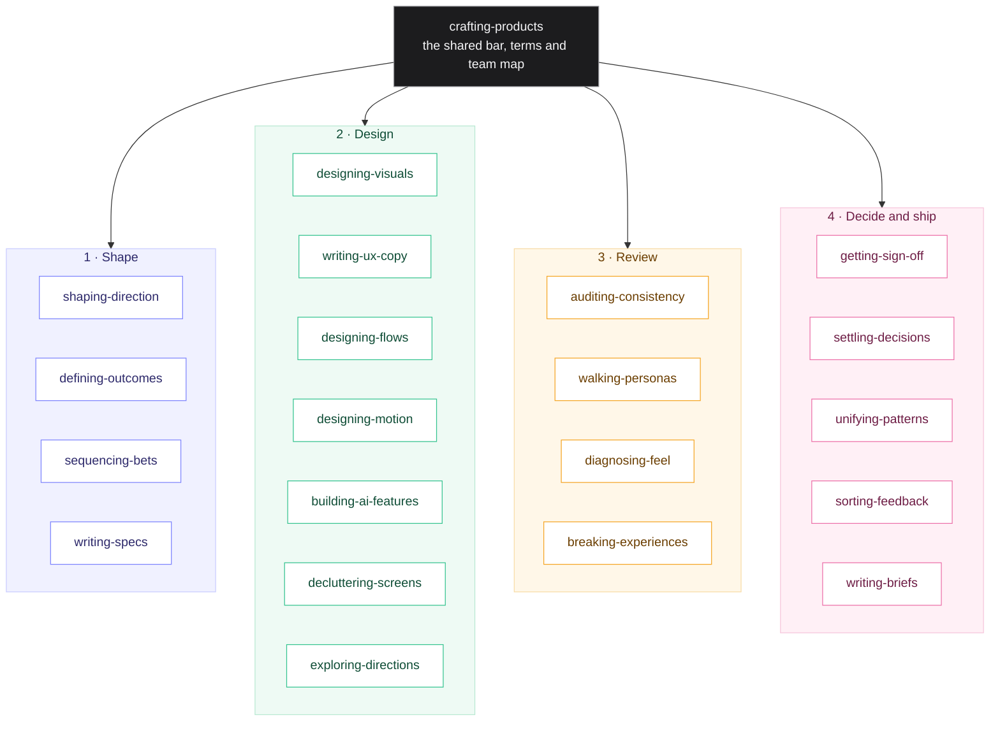

# Skills for Product Builders

Twenty-one Agent Skills that help Claude shape, design, build and ship excellent products: problems worth solving, outcomes worth measuring, calm and honest interfaces, precise words, well-timed motion, AI features people can trust, and experiences broken on purpose before anyone else meets them. Every skill applies equally to iPhone, iPad, Mac and the web, and works in Claude Code and Codex.

The bar is Apple's restraint and Linear's discipline, grounded in the public work of product leaders such as Marty Cagan, Teresa Torres and Katie Dill.

## Who it's for

People who want to build excellent things, whatever their title.

| You are | Start with | What you get |
| --- | --- | --- |
| **Product manager or leader** | `shaping-direction`, `defining-outcomes`, `sequencing-bets`, `writing-specs` | A direction tested against all four risks, outcomes that measure behaviour, a roadmap of bets, and specs builders can act on |
| **Design engineer** | `designing-visuals`, `designing-flows`, `designing-motion`, `writing-ux-copy` | Screens with one clear action, flows that never overwhelm, motion that feels native, and words that get to the point |
| **Engineer** | `breaking-experiences`, `diagnosing-feel`, `unifying-patterns`, `writing-specs` | Edge cases found and kept as tests, "it feels off" turned into a measured fix, and one answer per pattern with a guard |
| **Founder or solo builder** | `crafting-products`, then whichever skill the work calls for | A shared quality bar and a team of specialists that hands work to each other |

## Why this exists

Good products depend on hundreds of small decisions made the same way every time: the right problem, one focal point, the shortest words that stay true, a transition that lands softly, an empty state that tells the truth, an edge case caught before launch. Without a shared standard, every session starts from zero and the same corrections get repeated. These skills write that standard down once, so Claude applies it every time without being reminded.

## What it stands for

- **Simplicity is the ultimate sophistication.** One screen, one job, one primary action. More screens beat a crowded one.
- **Progressive disclosure.** The common path first; everything else one level deeper.
- **Structure, not decoration.** Beautiful because it is well structured.
- **Words are interface.** The fewest words that stay true: to the point, never vague.
- **Motion has a job.** Smooth, seamless and well timed; never rushed, hectic or flashy.
- **Outcomes over output.** A change in what people do, not a feature shipped.
- **Truth before polish.** Nothing shown that the data cannot back.
- **Native to every device.** Designed for each, consistent across all.
- **Proven, not assumed.** Measured on the device, broken on purpose before people meet it, and every fix leaves a guard.

## How it works

Skills load in layers, so Claude only reads what a task needs:

1. **Descriptions** of every skill are always visible to Claude, so it knows what each one is for.
2. **A skill's instructions** load when a task matches it.
3. **Reference files** (motion values, platform conventions, techniques) load only when the skill points to them.

The skills work as a team. `crafting-products` is the foundation: the shared bar, the shared vocabulary and the map of who leads what. Each specialist does one job deeply and hands the rest to a teammate.



### Common plays

| The work | Lead | Then |
| --- | --- | --- |
| Decide what to build, or whether an idea is worth it | `shaping-direction` | `defining-outcomes`, `exploring-directions`, `settling-decisions` |
| Set goals or say how success is measured | `defining-outcomes` | `settling-decisions` |
| Order more ideas than there is time for | `sequencing-bets` | `settling-decisions`, `writing-briefs` |
| Write a spec, PRD or plan for builders or agents | `writing-specs` | `designing-flows`, `walking-personas` |
| Build or change a screen | `designing-visuals` | `writing-ux-copy` for the words, `designing-motion` for transitions, `walking-personas` for every state |
| Design a sign-up, onboarding, setup or checkout flow | `designing-flows` | `writing-ux-copy`, `designing-visuals`, `walking-personas` |
| Explore an idea with no obvious answer | `exploring-directions` | `settling-decisions`, then `getting-sign-off` |
| Get sign-off on proposed changes | `getting-sign-off` | `settling-decisions` for open rows, then build |
| Something feels laggy, jumpy, flashy or rushed | `diagnosing-feel` | `designing-motion` |
| Break a feature on purpose and find its edge cases | `breaking-experiences` | `walking-personas`, then the skill that owns each fix |
| Plan or review motion | `designing-motion` | `diagnosing-feel` to prove it |
| Find and fix inconsistency | `auditing-consistency` | `getting-sign-off`, `settling-decisions`, `unifying-patterns` |
| Simplify a feature | `decluttering-screens` | `getting-sign-off` |
| Design or ship an AI feature | `building-ai-features` | `writing-ux-copy`, `designing-flows` |
| Turn feedback into actions | `sorting-feedback` | `settling-decisions`, `getting-sign-off` |
| Explain work to a non-technical reader | `writing-briefs` | |

## The skills

### Foundation

| Skill | What it does best | What you get |
| --- | --- | --- |
| [`crafting-products`](crafting-products/SKILL.md) | Holds every piece of work to one bar: calm, simple, consistent, honest, native to each device. Points each part of the work to the right specialist. | The principles, the shared terms, the team map and a screen check. Platform conventions for iPhone, iPad, Mac and the web in [PLATFORMS.md](crafting-products/PLATFORMS.md), and how people read text in [READING.md](crafting-products/READING.md). |

### Shape

| Skill | What it does best | What you get |
| --- | --- | --- |
| [`shaping-direction`](shaping-direction/SKILL.md) | Turns a vague opportunity or a feature request into a direction worth testing, from the person and the moment they struggle in. | Two or three approaches with one recommended, a one-sentence hypothesis, the riskiest assumptions, and the cheapest test with its pass mark written first. |
| [`defining-outcomes`](defining-outcomes/SKILL.md) | Says what success means before the work starts, as a change in what people do. | One primary metric with its exact definition, what the business captures, a countermetric, baseline, target, date and go or no-go points. |
| [`sequencing-bets`](sequencing-bets/SKILL.md) | Orders more ideas than there is time for by opportunity cost, evidence and what unblocks learning. | Now, Next and Later against ranked problems, an appetite and a stop rule per bet, and a Not doing list with reasons. |
| [`writing-specs`](writing-specs/SKILL.md) | Writes the definition builders and agents work from, sized to the work. | The problem in numbers, the perimeter, the flow at sketch level, every state, the data model and API sketch, checks that prove it done, and a decision log. |

### Design

| Skill | What it does best | What you get |
| --- | --- | --- |
| [`designing-visuals`](designing-visuals/SKILL.md) | Gives a screen one focal point, a clear order of importance, one rhythm of space and contrast where it matters, then checks it rendered. | A critique with every fix as a value ("gap 12 to 24"), four visual tests and a 1 to 5 scorecard where nothing ships below 4. |
| [`writing-ux-copy`](writing-ux-copy/SKILL.md) | Writes words that get to the point without going vague, for the screen's one mission, never lifted from a reference. | New copy or a review with today, proposed and the rule behind each change, calibrated against "too long, too vague, right" examples. |
| [`designing-flows`](designing-flows/SKILL.md) | Shapes any multi-step flow so every step has one mission and one action, value comes before asks, and nothing is lost. | A step card per step (mission, action, asks, defaults), every branch designed, and a library of UX techniques in [TECHNIQUES.md](designing-flows/TECHNIQUES.md). |
| [`designing-motion`](designing-motion/SKILL.md) | Keeps every transition and loading moment smooth, seamless and well timed, with one vocabulary of named roles. | An audit of every move with its fix, and default durations, curves, springs and loading rules in [DEFAULTS.md](designing-motion/DEFAULTS.md). |
| [`building-ai-features`](building-ai-features/SKILL.md) | Makes AI features trustworthy: labels that match results, nothing lost or sent without a yes, an evaluation gate before shipping. | A trust check and a pass-or-hide decision per AI action, with pass marks written before results exist. |
| [`decluttering-screens`](decluttering-screens/SKILL.md) | Simplifies an existing feature radically without removing a single capability. | Before-and-after counts per screen and proof that every capability is still reachable. |
| [`exploring-directions`](exploring-directions/SKILL.md) | Shows two to four genuinely different directions in the real interface, each with its trade-off, and recommends one. | A comparison canvas answered with a letter. |

### Review

| Skill | What it does best | What you get |
| --- | --- | --- |
| [`auditing-consistency`](auditing-consistency/SKILL.md) | Goes from one noticed difference to every place the same job is done, on every device, measured. | An inventory per job, one proposed answer each, and the guard that stops drift returning. |
| [`walking-personas`](walking-personas/SKILL.md) | Walks a flow as the people the demo account never is: nothing yet, thin, typical, maximum, messy. | Findings per persona, every one reproducible from a link, plus the personas the product cannot yet simulate. |
| [`diagnosing-feel`](diagnosing-feel/SKILL.md) | Turns "it doesn't feel right" into a measured cause, a fix at that cause and a guard. | The moment named with a timestamp, the cause in one sentence with evidence, and before-and-after proof on the real device. |
| [`breaking-experiences`](breaking-experiences/SKILL.md) | Builds the controls that put the product into any state, breaks it on purpose by combining failures, data, time, permissions and devices, and keeps every break as a test. | Simulation controls anyone can rerun, breaks grouped by severity with reproductions, and an automated check per break seen failing first. |

### Decide and ship

| Skill | What it does best | What you get |
| --- | --- | --- |
| [`getting-sign-off`](getting-sign-off/SKILL.md) | Gets sign-off one change at a time, with the same real screen today and proposed side by side. | A published review page where each row is answered Agree, Not this or Discuss, and only agreed rows get built. |
| [`settling-decisions`](settling-decisions/SKILL.md) | Settles open questions one at a time, each with real options and one recommendation. | Recorded decisions, before anything is built. |
| [`unifying-patterns`](unifying-patterns/SKILL.md) | Builds an agreed consolidation so the old answer can never come back. | A pull request with every caller moved, old variants deleted, and a guard seen failing on the old code. |
| [`sorting-feedback`](sorting-feedback/SKILL.md) | Sorts what people said into what to act on, grounded in the product. | Five groups: do now, ask, park, not doing, already handled, each item with the line that raised it. |
| [`writing-briefs`](writing-briefs/SKILL.md) | Explains work to a smart reader who is not technical, recommendation first. | A brief, a reply ready to paste, or a deck outline. |

## Always on

[`house-rules.md`](house-rules.md) is the short core I keep in `~/.claude/CLAUDE.md`, which Claude reads at the start of every session; the skills hold the depth and load only when a task needs them. It is written in my voice and includes personal preferences (no em dashes, installing builds on my devices). Treat it as an example to adapt, not a file to copy as is.

## Install

**Claude Code, for all your projects.** Link each skill folder into your personal skills folder:

```bash
git clone https://github.com/bymw/skills.git ~/Github/skills
for d in ~/Github/skills/*/; do [ -f "$d/SKILL.md" ] && ln -s "$d" ~/.claude/skills/; done
```

**Codex, for all your projects.** Codex reads the same format from `~/.agents/skills`:

```bash
mkdir -p ~/.agents/skills
for d in ~/Github/skills/*/; do [ -f "$d/SKILL.md" ] && ln -s "$d" ~/.agents/skills/; done
```

**Claude Code, for one project.** Copy the skill folders you want into the project's `.claude/skills/` folder.

**Claude apps.** Zip a skill folder and upload it in the skills section of Claude's settings. Each skill works on its own; teammates it mentions are used when they are also installed.

### What each host needs

Every skill works anywhere the Agent Skills format is supported. A few use host features when they exist, and fall back when they do not:

| Skill | Uses when available | Fallback |
| --- | --- | --- |
| `getting-sign-off`, `exploring-directions`, `unifying-patterns` | A published page with a data store (Claude artifacts) | A local HTML page, with answers given in chat |
| `settling-decisions` | The host's question tool | Questions in plain text |
| `diagnosing-feel` | macOS and Swift, for its frame-measuring script | The browser's or platform's own profiler |
| `designing-visuals`, `walking-personas`, `breaking-experiences` | A device, simulator or browser to render and run on | Says plainly what could not be verified |

**With the skills CLI**, once the repository is public:

```bash
npx skills add bymw/skills
```

### Pairs well with

- [Emil Kowalski's skills](https://github.com/emilkowalski/skills) for the craft of individual animations and components: `npx skills add emilkowalski/skills`
- [Apple's Human Interface Guidelines](https://developer.apple.com/design/human-interface-guidelines) for platform detail

The Shape skills are grounded in the public work of product leaders including Marty Cagan, Teresa Torres, Bob Moesta, Robby Stein, Shreyas Doshi, Itamar Gilad and Ryan Singer, paraphrased as principles and credited in each skill.

## Inside a skill

Every specialist skill has the same shape, so they read as one set. The foundation, `crafting-products`, holds the principles, shared terms, team map and screen check instead.

```
skill-name/
├── SKILL.md          name and description, then:
│                     two failure modes (the first is worse)
│                     rules, each with its reason
│                     method, step by step
│                     output format
│                     gotchas (instead of this, do that)
│                     works with (the teammates it hands to)
└── REFERENCE.md      optional detail, read only when the skill points to it
```

```
skills/
├── README.md
├── LICENSE
├── house-rules.md
├── evals/                  three scenarios and six trigger checks per skill
├── crafting-products/      SKILL.md, PLATFORMS.md, READING.md
├── shaping-direction/      SKILL.md
├── defining-outcomes/      SKILL.md
├── sequencing-bets/        SKILL.md
├── writing-specs/          SKILL.md
├── designing-visuals/      SKILL.md
├── writing-ux-copy/        SKILL.md
├── designing-flows/        SKILL.md, TECHNIQUES.md
├── designing-motion/       SKILL.md, DEFAULTS.md, ROLES.md
├── building-ai-features/   SKILL.md
├── decluttering-screens/   SKILL.md, MOVES.md
├── exploring-directions/   SKILL.md, AXES.md
├── auditing-consistency/   SKILL.md, JOBS.md
├── walking-personas/       SKILL.md, PERSONAS.md
├── diagnosing-feel/        SKILL.md, MEASURE.md, frames.swift
├── breaking-experiences/   SKILL.md, BREAKS.md
├── getting-sign-off/       SKILL.md, CAPTURE.md, review-page.html
├── settling-decisions/     SKILL.md
├── unifying-patterns/      SKILL.md, GUARDS.md
├── sorting-feedback/       SKILL.md
└── writing-briefs/         SKILL.md, SHAPES.md
```

## Evaluations

Every skill has three test scenarios and at least six trigger checks in [`evals/`](evals/), in the structure Anthropic recommends: a realistic request, any input files, and the behaviours a good answer must show. Each scenario runs with the skill and without it, and the output is graded against those behaviours. The trigger checks confirm each description picks its own requests and leaves its neighbours' alone. See [evals/README.md](evals/README.md) to run them.

**Latest results** ([full table and limits](evals/RESULTS.md)): with the skills, answers showed 89% of the expected behaviours against 36% without (84% against 36% on the first, untuned run), and 130 of 131 trigger checks picked the right skill.

## Not covered yet

Honest gaps for a later version: running usability sessions with people (planning tasks, recruiting, moderating), a full accessibility audit, product-wide navigation and information architecture, and release management after sign-off.

## How the skills are written

They follow [Anthropic's skill authoring best practices](https://platform.claude.com/docs/en/agents-and-tools/agent-skills/best-practices), its prompting guidance for current Claude models, and the open [Agent Skills specification](https://agentskills.io/specification), cross-checked against OpenAI's guidance:

- **One focused job per skill.** Each description says what the skill does, when to use it and where its boundary is, with the trigger words first, so Claude or Codex picks the right one. Descriptions are kept short (about 7,900 characters for all twenty-one) because hosts budget the skill list; Codex shortens descriptions first when the budget is tight, so each puts its job and trigger words up front.
- **Calm and specific.** Rules give their reason where it is not obvious, and every gotcha names what to do instead.
- **Explicit scope.** Rules say "every screen, not just the first".
- **One vocabulary.** Shared terms are defined once in `crafting-products`, and each idea lives in the skill that owns it, with teammates pointing to it.
- **Shallow references.** Reference files sit one level deep, each with a line saying when to read it.
- **Complete reviews.** Review skills report every finding with its severity rather than filtering.
- **Tested.** Every skill has evaluations, and changes are checked blind against a no-skill baseline on realistic scenarios.

## Licence

MIT. See [LICENSE](LICENSE).

Made by [Marcus Wiberg](https://www.marcuswiberg.com).
